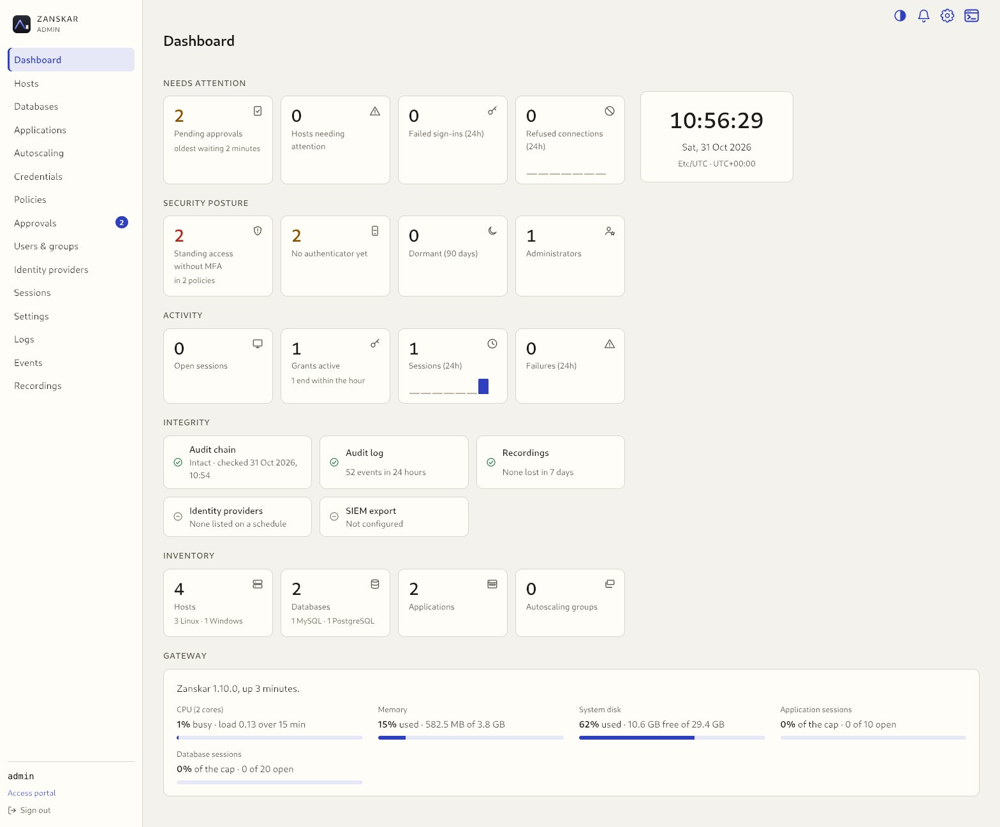
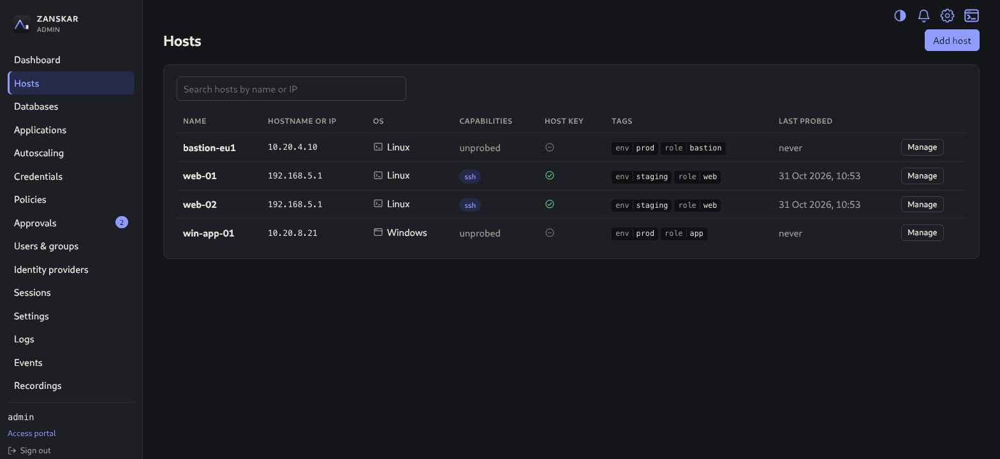
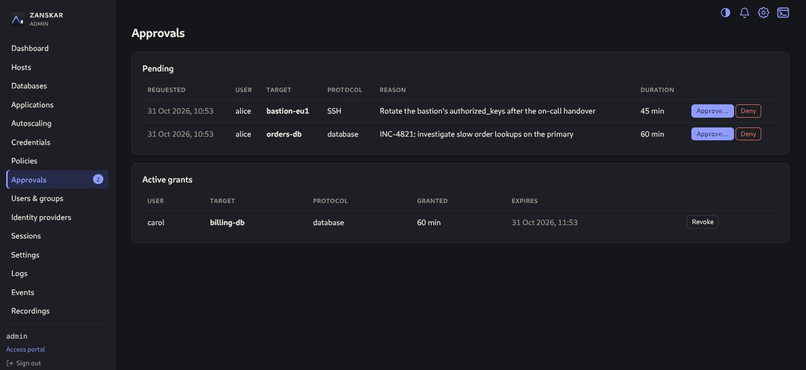
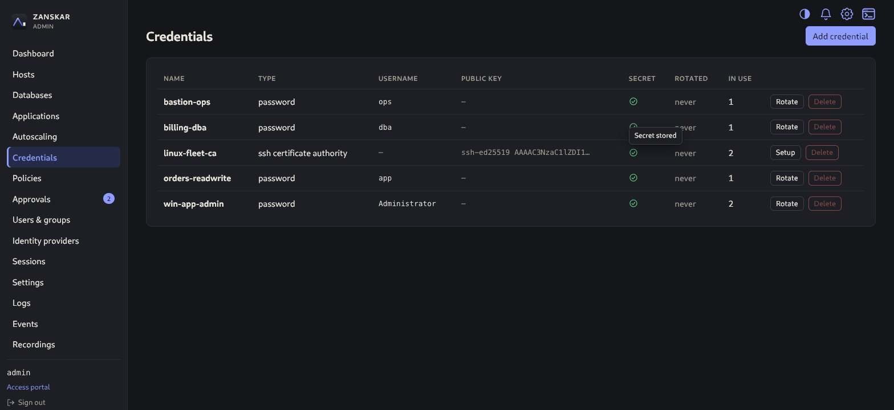
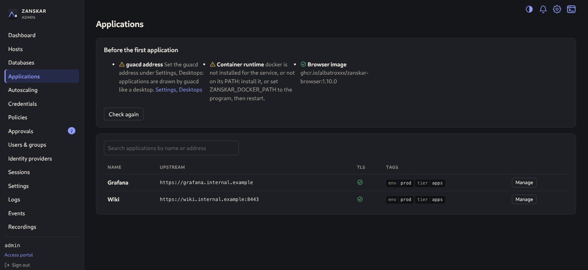
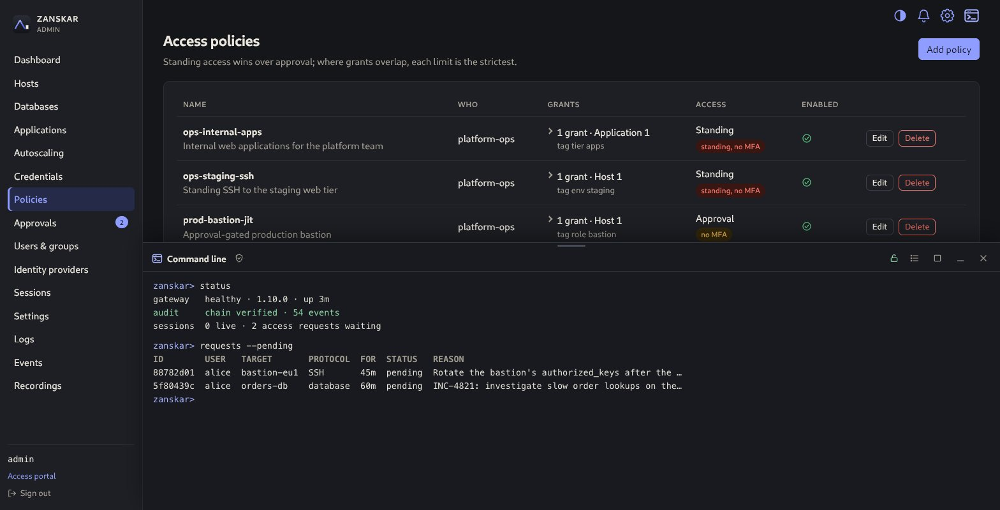
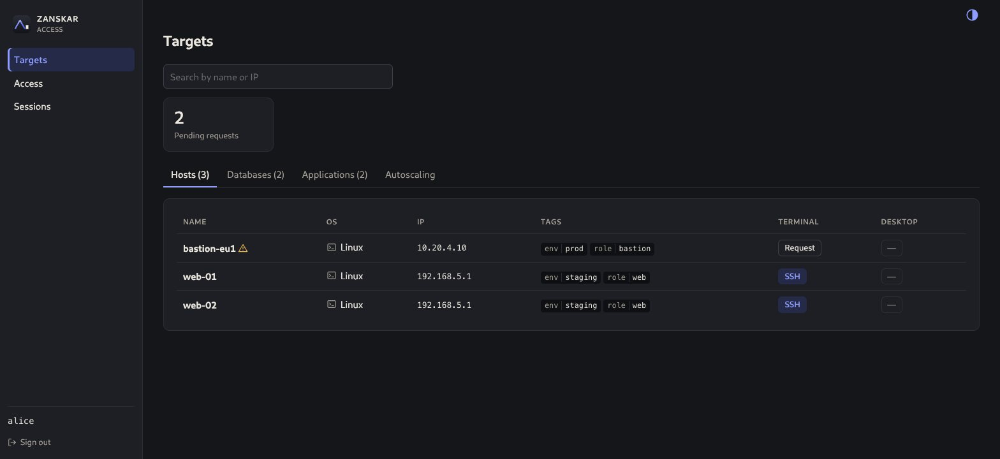

<p align="center">
  <picture>
    <source media="(prefers-color-scheme: dark)" srcset="docs/assets/logo-dark.svg">
    
  </picture>
</p>

<p align="center">
  
  <a href="https://github.com/albatroxxx/zanskar/releases/latest"></a>
  <a href="https://github.com/albatroxxx/zanskar/actions/workflows/ci.yml?query=branch%3Amain"></a>
  <a href="https://github.com/albatroxxx/zanskar/security/code-scanning"></a>
  <a href="https://scorecard.dev/viewer/?uri=github.com/albatroxxx/zanskar"></a>
  <a href="https://www.bestpractices.dev/projects/14924"></a>
  <a href="https://github.com/albatroxxx/zanskar/actions/workflows/ci.yml?query=branch%3Amain"></a>
  <a href="go.mod"></a>
  <a href="LICENSE"></a>
</p>

<h1 align="center">Zanskar</h1>

<p align="center"><strong>Browser sessions to the machines, databases and web applications you already run. Nothing to install on them.</strong></p>

<p align="center">
  <a href="https://albatroxxx.github.io/zanskar/docs/">Install</a> ·
  <a href="https://albatroxxx.github.io/zanskar/guide/">How-to guide</a> ·
  <a href="https://albatroxxx.github.io/zanskar/concepts/">Concepts</a> ·
  <a href="docs/architecture.md">Architecture</a> ·
  <a href="docs/threat-model.md">Threat model</a> ·
  <a href="https://albatroxxx.github.io/zanskar/releases/">Releases</a>
</p>

Zanskar is an open-source, **agentless** access gateway. People sign in once, pick a target, and
get a terminal (SSH, WinRM), a desktop (RDP, VNC), a database session (PostgreSQL, MySQL,
MariaDB) or a web application, in the browser. The gateway authenticates to the target with a
credential the person never sees, records the session, and writes every step to a hash-chained
audit log. Access can be standing or granted just in time on approval, and it ends the moment
it is taken away.

<p align="center">
  <a href="https://albatroxxx.github.io/zanskar/">
    <picture>
      <source media="(prefers-color-scheme: dark)" srcset="docs/assets/screenshots/dashboard.jpg">
      
    </picture>
  </a>
</p>

## Why Zanskar

- **Agentless, and the browser never touches the target.** Targets are reached over SSH, RDP, VNC,
  WinRM or the database's own protocol, from the gateway only. No agent, no inbound exposure, no
  client software.
- **Fleets that change are first-class.** Enrol an AWS Auto Scaling group through a read-only
  role; Zanskar tracks the healthy pool and, when the instance you are on is terminated, offers a
  switch to another instead of a dead terminal.
- **Evidence for everything.** Recorded sessions, audited reads of those recordings, a
  hash-chained audit log anchored by signatures and verifiable from the command line, SIEM export,
  and releases signed with Sigstore.

## What you get

| Capability | What it does |
|---|---|
| **Terminals** | SSH to Linux and PowerShell over WinRM to Windows, streamed over WebSocket and recorded as asciicast. SFTP beside the terminal, gated per policy. |
| **Desktops** | RDP and VNC through a guacd sidecar, recorded as a pixel stream, shadowable live by auditors. Clipboard and drive redirection are policy switches. |
| **Databases** | `psql`, `mysql` and `mariadb` sessions through a per-session client container. The database credential lives in a sidecar and never reaches the client, not even from a shell escape. TLS to the database is per target, up to `verify-full` with your CA bundle. |
| **Web applications** | An internal web application opens in a sandboxed Chromium container beside the gateway, streamed and recorded like a desktop, on a private network that reaches the application's one port and nothing else. Needs a container runtime on the gateway host, as database sessions do. |
| **Keyless SSH** | An SSH certificate authority that mints a minutes-long certificate per session, naming the Zanskar user in the target's own log. One `TrustedUserCAKeys` line per target, and a two-step rotation that never locks a host out. Vaulted passwords and keys remain for everything else. |
| **Just-in-time access** | A policy can grant eligibility instead of standing access: the user asks with a reason and a duration, an administrator approves, and the grant is time-boxed, extendable and expires on its own. |
| **Identity, kept separate** | Local accounts with Argon2id and TOTP, or OIDC and LDAP / Active Directory sign-in with audited group-to-role mapping. Who you are to Zanskar is distinct from how Zanskar reaches a target. Three roles: admin, auditor, user. |
| **Access taken away ends the session** | Disabling an account, changing its groups or revoking a policy ends the live sessions that access allowed, and tells the user why. |
| **Operated from the console** | HTTPS out of the box with a certificate the gateway manages, runtime settings applied live, recordings on local disk or an S3-compatible bucket, restart, update and host actions behind a fresh authenticator code, a Logs page, and an audited command line inside the console. |

## Install

Zanskar is one static binary with the console inside it. On a Linux server:

1. Download the `.deb` or `.rpm` for your architecture from the [latest release](https://github.com/albatroxxx/zanskar/releases/latest) and install it. Checksums are signed with Sigstore; the [install guide](https://albatroxxx.github.io/zanskar/docs/) has the `cosign verify` lines.
2. Run `sudo zanskar init`. It writes the configuration, serves HTTPS on 443 with a certificate it manages, creates the first administrator and prints what to do next.
3. Open the gateway's address in a browser, sign in, enrol your authenticator, and add a target.

For a container: `ghcr.io/albatroxxx/zanskar` with [`deploy/docker-compose.yml`](deploy/docker-compose.yml) brings up the gateway, guacd and Caddy for TLS. Desktops need the guacd sidecar; database and application sessions need Docker or Podman on the gateway host. The full picture, from topology to backups, is in [docs/deploy.md](docs/deploy.md).

To build from source you need Go 1.27 or newer and Node 22 or newer; [CONTRIBUTING.md](CONTRIBUTING.md) has the development setup.

## A look inside

<details>
<summary><strong>Hosts</strong>: Linux and Windows machines with their capabilities, host-key trust and tags</summary>
<br>

</details>

<details>
<summary><strong>Approvals</strong>: just-in-time requests waiting on a decision, and the grants in force</summary>
<br>

</details>

<details>
<summary><strong>SSH certificate authority</strong>: the one line each target needs, and a per-target test</summary>
<br>

</details>

<details>
<summary><strong>Web applications</strong>: enrolled by address, opened in an isolated browser</summary>
<br>

</details>

<details>
<summary><strong>The console's command line</strong>: audited, unlocked with an authenticator code</summary>
<br>

</details>

<details>
<summary><strong>The access portal</strong>: what a user sees</summary>
<br>

</details>

## How it works

```
 Browser ──HTTPS/WSS──▶ zanskar gateway ──SSH / WinRM / SFTP──────────────▶ Linux, Windows
                         │    │    │
                         │    │    └──Guacamole protocol──▶ guacd ──RDP/VNC─▶ Windows, VNC hosts
                         │    │                                    └─VNC──▶ isolated browser ──▶ web applications
                         │    └── per-session client container ─▶ relay sidecar ─PG / MySQL─▶ databases
                         │        (internal network; only the relay, which holds the
                         │         credential, reaches the database)
                         │
                         ├── SQLite or PostgreSQL (state, sealed secrets, audit chain)
                         ├── recordings: local disk or S3-compatible storage
                         ├── identity providers: OIDC, LDAP / Active Directory
                         └── AWS APIs: STS AssumeRole, Auto Scaling, EC2
```

One Go process: the API, the embedded React console, the protocol bridges and the audit chain.
Secrets are sealed under a versioned master key; the audit log is hash-chained and anchored by
signatures, so even its newest events cannot be removed unnoticed. Every design choice links to an
[architecture decision record](docs/adr/), and [docs/architecture.md](docs/architecture.md) walks
through a session end to end.

**Status.** Zanskar runs as a single instance: one gateway, embedded SQLite or your PostgreSQL,
a guacd sidecar for desktops. High availability is planned; the Helm chart deploys one pod and is
a preview until live sessions can be ended and watched across gateways.

## Documentation

| Where | What it covers |
|---|---|
| [Install](https://albatroxxx.github.io/zanskar/docs/) | Packages, the container, `zanskar init`, TLS, updates |
| [How-to guide](https://albatroxxx.github.io/zanskar/guide/) | Every console page, from the first host to the audit log |
| [Concepts](https://albatroxxx.github.io/zanskar/concepts/) | Targets, credentials, policies, grants, sessions, recordings |
| [Troubleshooting](https://albatroxxx.github.io/zanskar/troubleshooting/) | The exact messages a tester meets, and what they mean |
| [docs/deploy.md](docs/deploy.md) | Topology, backups, recording storage, database access, AWS enrolment, the certificate authority, the security checklist |
| [docs/architecture.md](docs/architecture.md) | How the gateway is built, package by package |
| [docs/threat-model.md](docs/threat-model.md) | Trust boundaries, what is defended against, what is not |
| [docs/adr/](docs/adr/) | The decisions behind the design, with their reasoning |
| [docs/api/openapi.yaml](docs/api/openapi.yaml) | The HTTP API the console uses, which is the API you get |
| [docs/console-cli.md](docs/console-cli.md) | Every command of the console's command line |
| [Release notes](https://albatroxxx.github.io/zanskar/releases/) | What changed, and how to upgrade |

## Quality and security signals

Every badge at the top is computed from this repository by an open-source tool and links to its evidence.

| Badge | What it measures | Source |
|---|---|---|
| CI | Build, `go vet`, race tests on SQLite and PostgreSQL, golangci-lint, govulncheck, gosec, gitleaks, OSV-Scanner, Trivy on the source tree and the built container image, a browser end-to-end suite, the third-party-notice check, on every push and pull request | [`ci.yml`](.github/workflows/ci.yml) |
| CodeQL | Static analysis of the Go server and the TypeScript console with the `security-extended` query suite; alerts appear in the Security tab | [`codeql.yml`](.github/workflows/codeql.yml) |
| OpenSSF Scorecard | Supply-chain hygiene scored 0 to 10 by the [OpenSSF](https://scorecard.dev): pinned dependencies, token permissions, branch protection, SAST, vulnerability status, and more | [`scorecard.yml`](.github/workflows/scorecard.yml) |
| OpenSSF Best Practices | The [OpenSSF Best Practices](https://www.bestpractices.dev/) criteria for open-source projects: a documented contribution and vulnerability-reporting process, tests and CI, static and dynamic analysis, published cryptography, secure delivery. The answers are public and linked to their evidence | [project 14924](https://www.bestpractices.dev/projects/14924) |
| Test coverage | Statement coverage of the gateway's own code from the CI test run, written to the `badges` branch after each push to main | [`ci.yml`](.github/workflows/ci.yml) |
| Go version | Read from `go.mod` | shields.io |

The published images are re-scanned by Trivy every week, because new advisories appear after a
release; findings land in the Security tab ([`image-scan.yml`](.github/workflows/image-scan.yml)).
Releases carry an SBOM, SLSA provenance and Sigstore signatures, and the builds are reproducible
across machines.

## Contributing

Contributions are welcome. To report a bug or suggest something, open an issue; the bug report
and feature request forms walk you through what to include. [CONTRIBUTING.md](CONTRIBUTING.md)
has the development setup, the checks that must pass before a pull request, and the project's
conventions. The short version:

```sh
make all   # linters, race-detector tests, the console build and its tests, the binary
```

How the project is run and how decisions are made is in [GOVERNANCE.md](GOVERNANCE.md); everyone
taking part follows the [code of conduct](CODE_OF_CONDUCT.md). The answers behind the project's
OpenSSF Best Practices badge are in [docs/best-practices.md](docs/best-practices.md).

## Security

Zanskar is an access gateway, so security reports matter. [SECURITY.md](SECURITY.md) says how to
report a vulnerability privately; never open a public issue for one. The
[threat model](docs/threat-model.md) describes what Zanskar defends against and what it does not.

## License

Apache License 2.0; see [LICENSE](LICENSE). The third-party components compiled into the binary
and their license texts are in [THIRD_PARTY_NOTICES.md](THIRD_PARTY_NOTICES.md), and the bundled
non-code assets in [THIRD_PARTY_LICENSES.md](THIRD_PARTY_LICENSES.md).

Zanskar is named after the [Zanskar Valley](https://en.wikipedia.org/wiki/Zanskar) in Ladakh, in
the Himalayas of northern India. The logo is a shell prompt redrawn as a summit and a cursor.
