# Lifecycles

Generated from the declarations in the code (`go run ./hack/gen-lifecycles > docs/lifecycles.md`);
do not edit by hand. [ADR 0047](adr/0047-lifecycles-declared-once.md) is the decision.

Every record below has a stored `status` (what was set) and a computed `state` (what holds now,
from the row and the clock), or only the latter. The field named under each heading carries the state
on the wire; its OpenAPI enum, the console's labels in `web/src/api/states.ts` and this document are
held to the declaration by the tests in `cmd/zanskar/lifecycles_test.go`. A move is drawn with what
makes it: an audit action where one is recorded, otherwise the code path in words.

## Session

Field `state` on `OwnSession`, `AccessSession`. States: `live`, `ended`.

`live` while `ended_at` is null, else `ended`; `end_reason` says why and `end_detail` what was said. The row cannot tell a session that is still starting (dialling, pulling images) or still closing (uploading its recording) from one that is bridging: those phases live in the gateway's registry and starting set, and the sweep closes a row older than three minutes that neither knows.


| From | To | By |
|---|---|---|
| live | ended | the bridge returns (end_reason says why) |
| live | ended | session.terminate |
| live | ended | the sweep: error, or gateway_restart at start |

- End reasons: `user_exit`, `idle_timeout`, `max_duration`, `admin_terminated`, `policy_revoked`, `trust_lost`, `gateway_restart`, `target_lost`, `target_deleted`, `failover`, `error`, `no_watcher`.
- `no_watcher` is kept for rows 1.15.0 ended under four eyes; nothing writes it since 1.16.0.
- A session's recording has a lifecycle of its own, below; `recording_state` carries it on the session for reviewers.

## Recording

Field `state` on `Recording`. States: `recording`, `finished`, `lost`, `purged`, `discarded`.

`discarded` when `discarded_at` is set, else `purged` when `purged_at` is set, else `finished` when `finished_at` is set, else `lost` when the session has ended, else `recording`. A session carries the same word as `recording_state` (reviewers only).

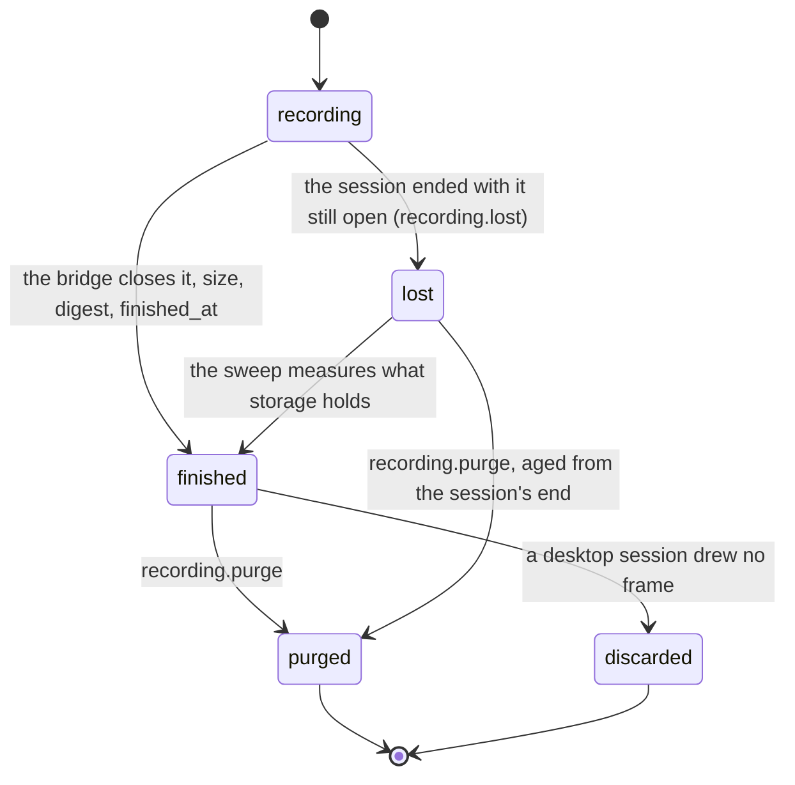

| From | To | By |
|---|---|---|
| recording | finished | the bridge closes it: size, digest, finished_at |
| recording | lost | the session ended with it still open (recording.lost) |
| lost | finished | the sweep measures what storage holds |
| finished | purged | recording.purge |
| lost | purged | recording.purge, aged from the session's end |
| finished | discarded | a desktop session drew no frame |

- A discarded recording is left out of the sessions list by the join; its row stays so the events that name it resolve.
- `lost` is also an audit event (`recording.lost`) and a notification; the row itself keeps `finished_at` null.

## Target

Field `state` on `Target`, `AutoscalingGroup`. States: `active`, `disabled`, `retired`.

The stored `status`. A retired row (`deleted_at` set) is read by no list or lookup, so `retired` never reaches the wire; it is declared so the document says where a deleted target goes.

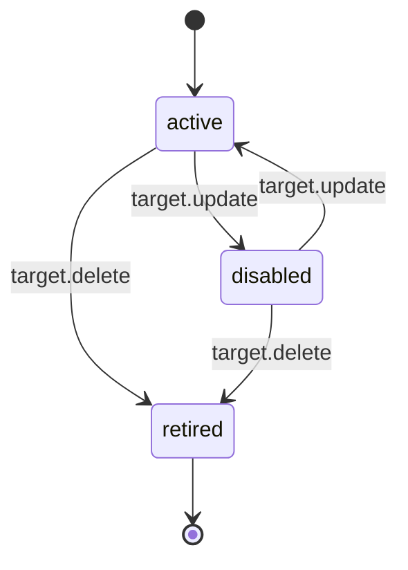

| From | To | By |
|---|---|---|
| active | disabled | target.update |
| disabled | active | target.update |
| active | retired | target.delete |
| disabled | retired | target.delete |

- Retiring sets `status` to `disabled` as well, so every reader must add `deleted_at IS NULL`; the repository does.
- An update that leaves `status` out writes `active`: the API default, not the current value (OpenAPI `TargetWrite`).
- Autoscaling groups (`AutoscalingGroup.state`) follow the same lifecycle with `asg.update` and `asg.delete`.

## Host key

Field `host_key_status` on `Target`, `ProbeResult`. States: `unknown`, `pending`, `trusted`, `changed`.

The stored `host_key_status`; `host_key_fingerprint` is the key it speaks of.

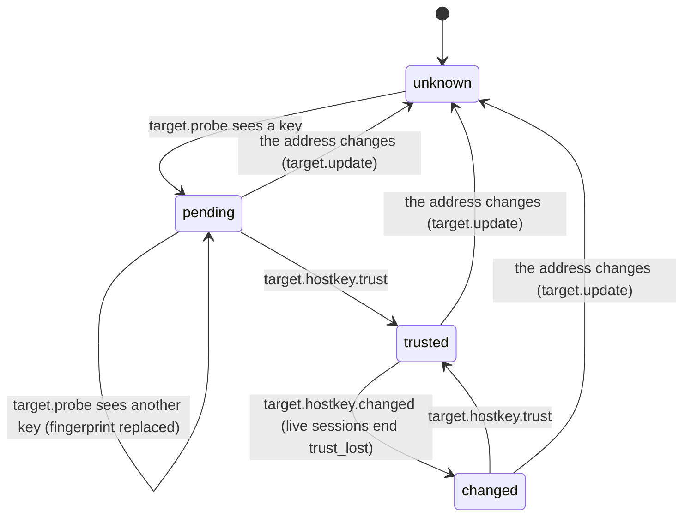

| From | To | By |
|---|---|---|
| unknown | pending | target.probe sees a key |
| pending | pending | target.probe sees another key (fingerprint replaced) |
| pending | trusted | target.hostkey.trust |
| trusted | changed | target.hostkey.changed (live sessions end trust_lost) |
| changed | trusted | target.hostkey.trust |
| pending | unknown | the address changes (target.update) |
| trusted | unknown | the address changes (target.update) |
| changed | unknown | the address changes (target.update) |

- A key seen at a dial that differs from the trusted one is refused and audited (`target.hostkey.mismatch`) but changes no state: only a probe does.
- `unknown` also reads for a database or application, which is never probed for a key; the console hides it there.

## Certificate pin

Field `tls_status` on `Target`. States: `none`, `pinned`, `changed`.

`none` with no pin, `changed` while a pending fingerprint waits beside the pin, else `pinned`; `winrm_tls_status` is the same for the WinRM listener.

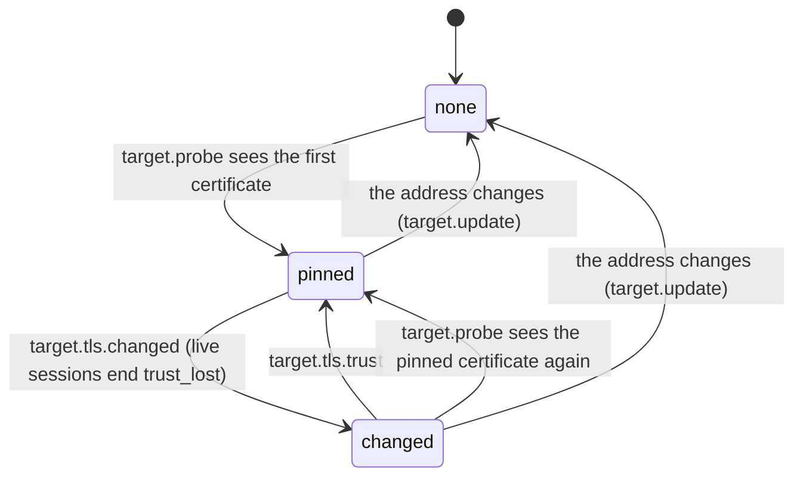

| From | To | By |
|---|---|---|
| none | pinned | target.probe sees the first certificate |
| pinned | changed | target.tls.changed (live sessions end trust_lost) |
| changed | pinned | target.tls.trust |
| changed | pinned | target.probe sees the pinned certificate again |
| pinned | none | the address changes (target.update) |
| changed | none | the address changes (target.update) |

- Unlike the host key, the first certificate is pinned by the probe with no administrator's word, and a pending certificate does not stop a ticket: the session fails at redeem with `certificate_mismatch`.

## Autoscaling instance

Field `state` on `AsgInstance`. States: `healthy`, `unhealthy`, `terminated`.

`terminated` when `terminated_at` is set; else `healthy` when `healthy` holds (in service, load balancer healthy or absent, probe healthy); else `unhealthy`. A first sighting lands in `healthy` or `unhealthy`.

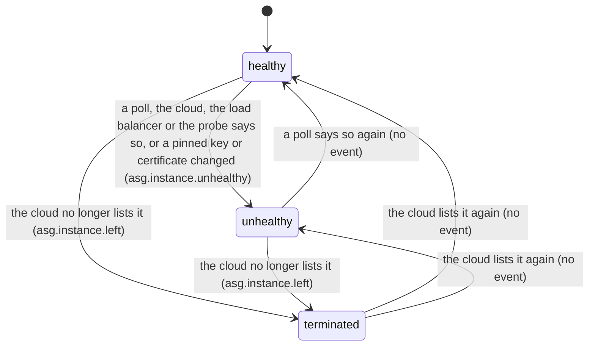

| From | To | By |
|---|---|---|
| healthy | unhealthy | a poll: the cloud, the load balancer or the probe says so, or a pinned key or certificate changed (asg.instance.unhealthy) |
| unhealthy | healthy | a poll says so again (no event) |
| healthy | terminated | the cloud no longer lists it (asg.instance.left) |
| unhealthy | terminated | the cloud no longer lists it (asg.instance.left) |
| terminated | healthy | the cloud lists it again (no event) |
| terminated | unhealthy | the cloud lists it again (no event) |

- Health has no time bound: a group that stops polling (disabled, or its sync failing) keeps each instance's last verdict.
- An instance whose pinned host key or certificate changed stays `unhealthy` while it presents the new one; no accept action exists.

## User

Field `state` on `User`. States: `active`, `locked_out`, `disabled`, `locked`.

`disabled` and `locked` are the stored `status`; an `active` account with `locked_until` in the future is `locked_out`; otherwise `active`. `directory_removed_at` beside `disabled` says the directory took the person away.

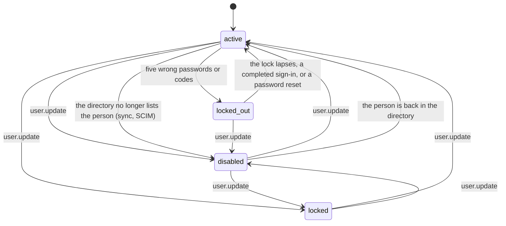

| From | To | By |
|---|---|---|
| active | locked_out | five wrong passwords or codes |
| locked_out | active | the lock lapses, a completed sign-in, or a password reset |
| active | disabled | user.update |
| active | disabled | the directory no longer lists the person (sync, SCIM) |
| locked_out | disabled | user.update |
| disabled | active | user.update |
| disabled | active | the person is back in the directory |
| active | locked | user.update |
| locked | active | user.update |
| disabled | locked | user.update |
| locked | disabled | user.update |

- `locked` behaves exactly like `disabled` and only a raw PUT sets it; whether to retire it is an open question of ADR 0047.
- Setting `status: active` does not clear a lockout; a password reset or a completed sign-in does.
- Deleting an account removes its row (ADR 0046): deletion is not a state.

## Access request

Field `state` on `AccessRequest`. States: `pending`, `approved`, `denied`, `expired`, `revoked`.

The stored `status`, except that `approved` with `expires_at` at or before now reads `expired`: the sweeper writes `expired` once a minute, and the clock is the truth in between. A grant is active while `state` is `approved`.

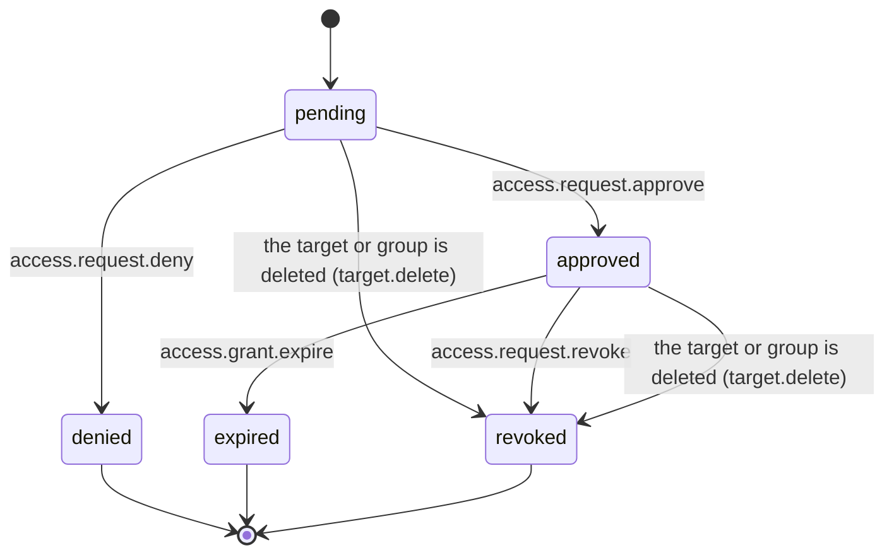

| From | To | By |
|---|---|---|
| pending | approved | access.request.approve |
| pending | denied | access.request.deny |
| pending | revoked | the target or group is deleted (target.delete) |
| approved | revoked | access.request.revoke |
| approved | revoked | the target or group is deleted (target.delete) |
| approved | expired | access.grant.expire |

- Revoke applies to an active grant only; a lapsed one answers 409 with the state named.
- A pending request never expires on its own and cannot be withdrawn by the requester.

## API token

Field `state` on `APIToken`. States: `active`, `expired`, `revoked`.

`revoked` when `revoked_at` is set, else `expired` when `expires_at` is at or before now, else `active`.

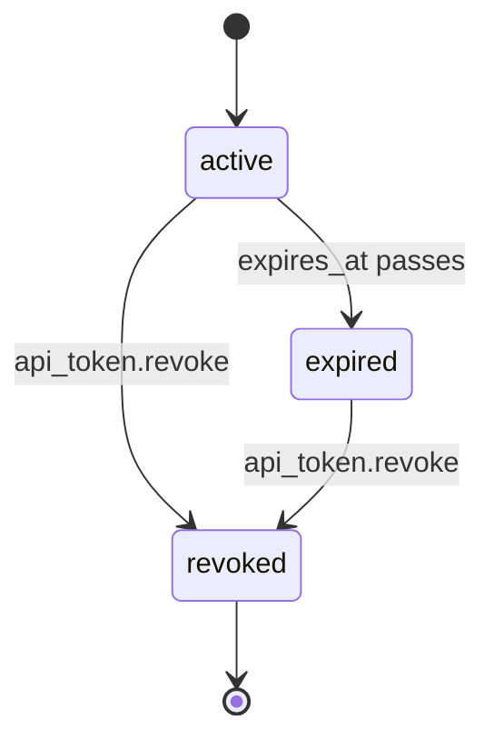

| From | To | By |
|---|---|---|
| active | expired | expires_at passes |
| active | revoked | api_token.revoke |
| expired | revoked | api_token.revoke |

- The owner's own state is not part of it: a token of a disabled, demoted or password-change-owing administrator reads `active` and is refused with 401 (ADR 0047, open question).
- Rows are never deleted; revoking twice keeps the first time.

## Authority rotation

Field `rotation_state` on `Credential`. States: `none`, `prepared`, `cut_over`.

`prepared` while `rotation.pending_public_key` is set, else `cut_over` while `rotation.retired_public_key` is set, else `none`. `ssh_ca` credentials only; absent on the others.

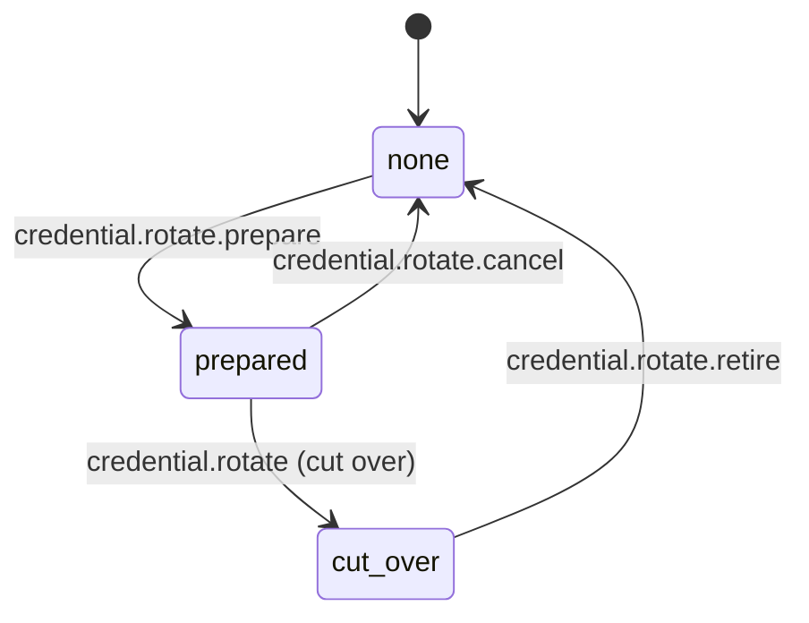

| From | To | By |
|---|---|---|
| none | prepared | credential.rotate.prepare |
| prepared | none | credential.rotate.cancel |
| prepared | cut_over | credential.rotate (cut over) |
| cut_over | none | credential.rotate.retire |

- One rotation at a time: preparing a next key is refused while a retired key waits to be confirmed removed (2026-11-09: the next cut-over overwrote the reminder).
- A row from before that rule may hold both keys; it reads `prepared`, and the console still shows both reminders.

## Access review

Field `review_state` on `AccessPolicy`. States: `never_reviewed`, `current`, `due`.

`never_reviewed` with no `reviewed_at`, `due` when it is older than ninety days, else `current`. The review view's `due` is the same rule.

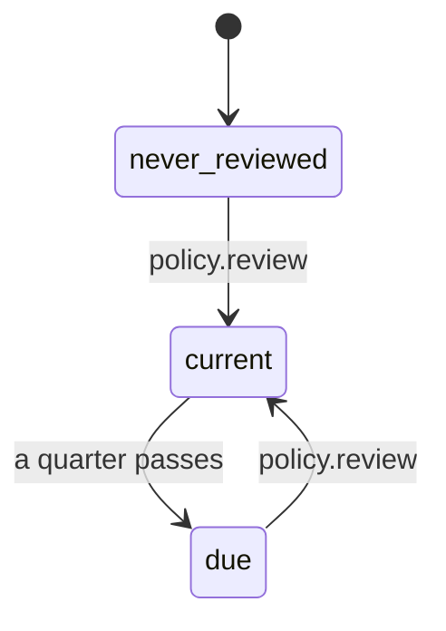

| From | To | By |
|---|---|---|
| never_reviewed | current | policy.review |
| current | due | a quarter passes |
| due | current | policy.review |

- Editing a policy does not reset its review.

## Environment file

Field `state` on `EnvFileReport`. States: `unchanged`, `changed`, `missing`, `unreadable`, `none`.

Diffed on each status read against the environment the process started with (secrets as digests), cached on the file's size and mtime. `restart_required` is `state == changed`.

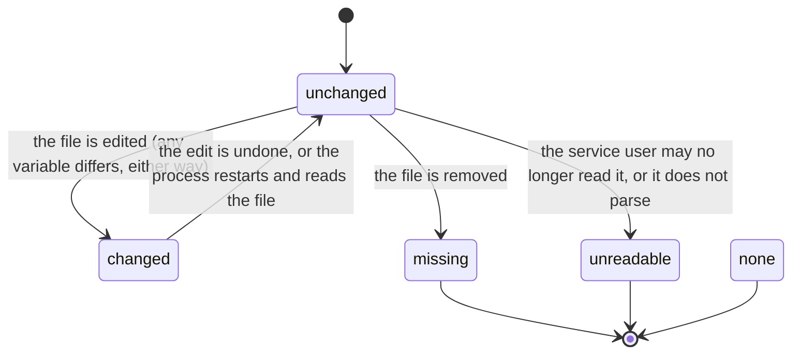

| From | To | By |
|---|---|---|
| unchanged | changed | the file is edited (any variable differs, either way) |
| changed | unchanged | the edit is undone, or the process restarts and reads the file |
| unchanged | missing | the file is removed |
| unchanged | unreadable | the service user may no longer read it, or it does not parse |

- `none`: no path is configured or found (a container whose environment came from elsewhere).

## TLS certificate source

Field `source` on `TLSCertInfo`. States: `generated`, `file`, `uploaded`.

`TLSStatus.active.source`; the mode (`file`, `managed`, `proxy`) is fixed for the process and says who terminates TLS, not which certificate.

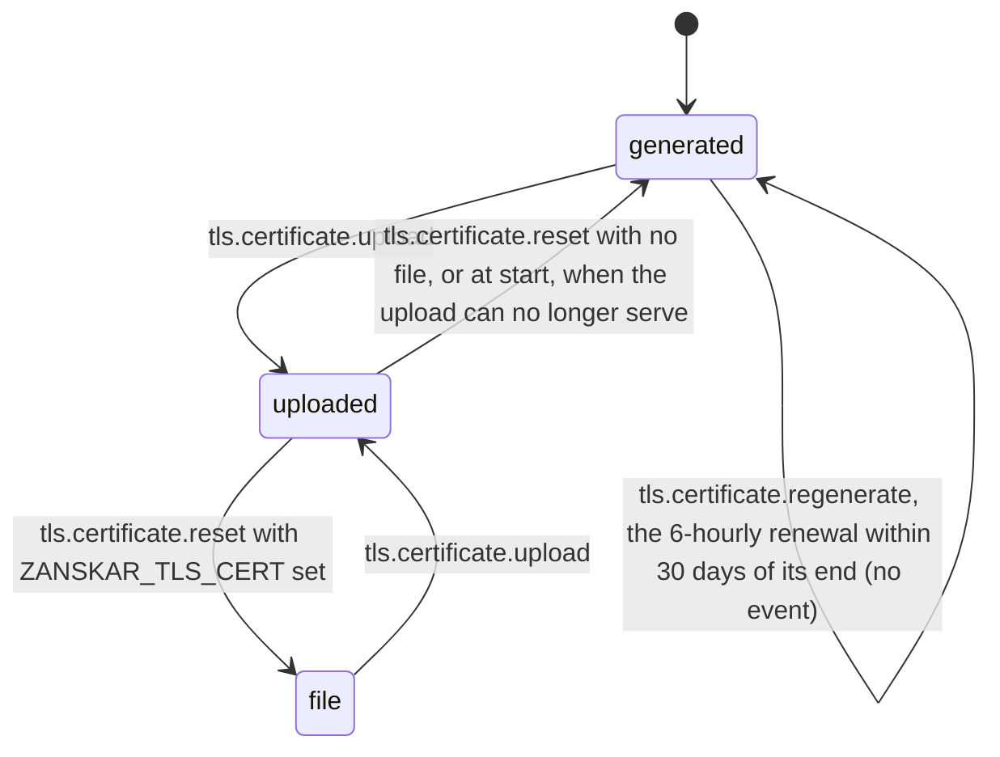

| From | To | By |
|---|---|---|
| generated | uploaded | tls.certificate.upload |
| file | uploaded | tls.certificate.upload |
| uploaded | file | tls.certificate.reset with ZANSKAR_TLS_CERT set |
| uploaded | generated | tls.certificate.reset with no file; or at start, when the upload can no longer serve |
| generated | generated | tls.certificate.regenerate; the 6-hourly renewal within 30 days of its end (no event) |

- An uploaded certificate that expires while the process runs keeps serving until a restart; only the generated one is renewed.

## Connect flow

No API field carries it. States: `requested`, `ticket issued`, `redeemed`, `starting`, `live`, `ending`, `closing`, `gone`.

In memory only. The row (`AccessSession.state`) says `live` from `starting` to `closing` and `ended` at `gone`; terminate, revocation, the caps and the drain act on the registry, which knows the session from `live` on.

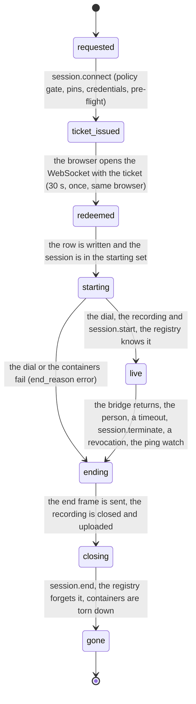

| From | To | By |
|---|---|---|
| requested | ticket issued | session.connect (policy gate, pins, credentials, pre-flight) |
| ticket issued | redeemed | the browser opens the WebSocket with the ticket (30 s, once, same browser) |
| redeemed | starting | the row is written and the session is in the starting set |
| starting | live | the dial, the recording and session.start; the registry knows it |
| starting | ending | the dial or the containers fail (end_reason error) |
| live | ending | the bridge returns: the person, a timeout, session.terminate, a revocation, the ping watch |
| ending | closing | the end frame is sent; the recording is closed and uploaded |
| closing | gone | session.end; the registry forgets it; containers are torn down |

- A session in `starting` (dialling, pulling images) cannot be terminated or revoked and is not counted by the caps: an open question of ADR 0047.
- The sweep closes a row older than three minutes that is neither in the registry nor in the starting set (`error`), and every open row at start (`gateway_restart`).
- Database sessions enter the registry before their containers start; application sessions after. The two therefore differ in what terminate reaches.

## Sign-in

No API field carries it. States: `password`, `verify`, `enroll`, `change`, `signed in`.

`LoginResponse.status` after the password or the change; `Me.pending` (`verify`, `enroll`, `password`) for a partial session that is read again; single sign-on enters at `signed in`, or at `verify` or `enroll` when the provider leaves the second factor to Zanskar.

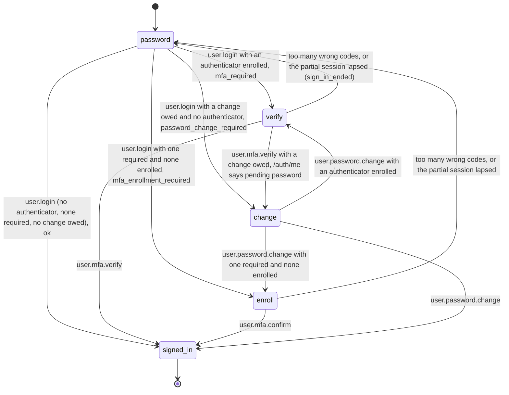

| From | To | By |
|---|---|---|
| password | signed in | user.login (no authenticator, none required, no change owed): ok |
| password | verify | user.login with an authenticator enrolled: mfa_required |
| password | enroll | user.login with one required and none enrolled: mfa_enrollment_required |
| password | change | user.login with a change owed and no authenticator: password_change_required |
| verify | signed in | user.mfa.verify |
| verify | change | user.mfa.verify with a change owed: /auth/me says pending password |
| enroll | signed in | user.mfa.confirm |
| change | signed in | user.password.change |
| change | verify | user.password.change with an authenticator enrolled |
| change | enroll | user.password.change with one required and none enrolled |
| verify | password | too many wrong codes, or the partial session lapsed (sign_in_ended) |
| enroll | password | too many wrong codes, or the partial session lapsed |

- The console's own step follows the gateway's word after every answer (2026-11-09: it stayed on the code form after a right code when a password change was owed).
- A partial session may call only the sign-in routes, `/auth/me` and `/auth/logout`.

## Sign-in session

No API field carries it. States: `partial`, `full`, `expired`, `revoked`, `swept`.

Usable while `revoked_at` is null, `expires_at` is ahead and `last_seen_at` is within the idle limit; `mfa_verified` tells partial from full. Idle expiry is known only to Lookup: nothing selects it, so an idle-ended row stays until the sweep.

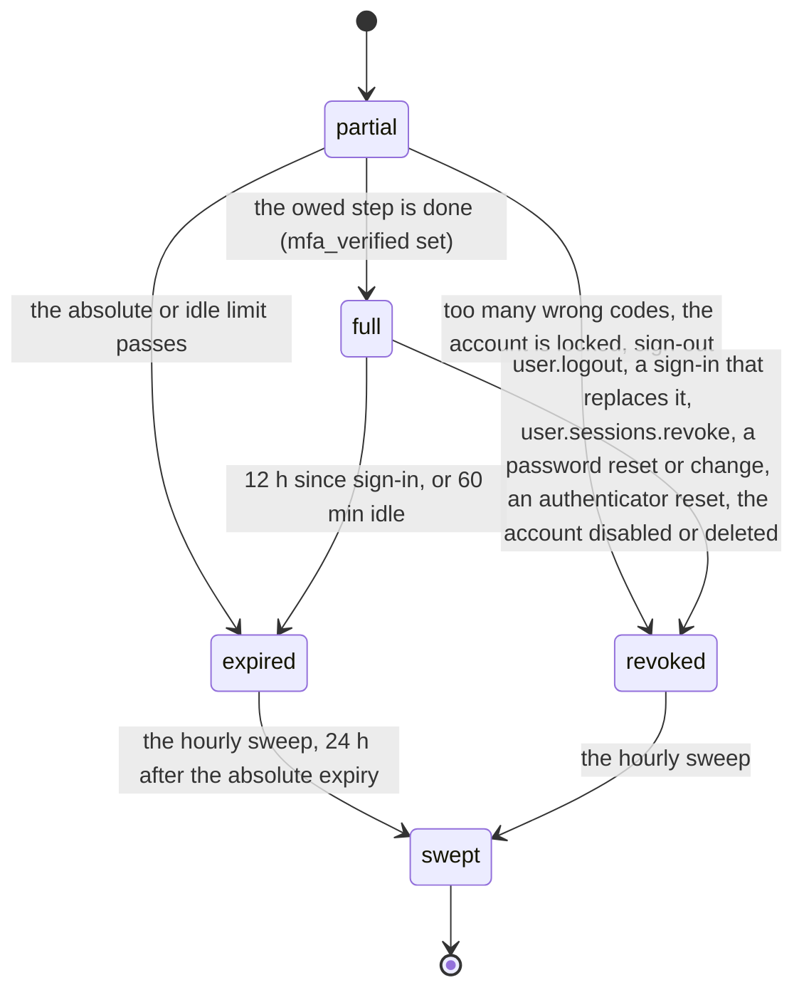

| From | To | By |
|---|---|---|
| partial | full | the owed step is done (mfa_verified set) |
| partial | revoked | too many wrong codes; the account is locked; sign-out |
| partial | expired | the absolute or idle limit passes |
| full | expired | 12 h since sign-in, or 60 min idle |
| full | revoked | user.logout, a sign-in that replaces it, user.sessions.revoke, a password reset or change, an authenticator reset, the account disabled or deleted |
| expired | swept | the hourly sweep, 24 h after the absolute expiry |
| revoked | swept | the hourly sweep |

- `mfa_verified_at` is the proof a code was typed; three windows read it (5 min for step-up, 15 min with a slide for the command line, 5 min from sign-in to enrol without a password).
- A disabled account's session is not revoked by the check that notices it; each status writer revokes.

## Authenticator

No API field carries it. States: `none`, `enrolling`, `confirmed`.

No row is `none`; a row with `confirmed_at` null is `enrolling`; `confirmed_at` set is `confirmed` (`Me.mfa_enrolled`).

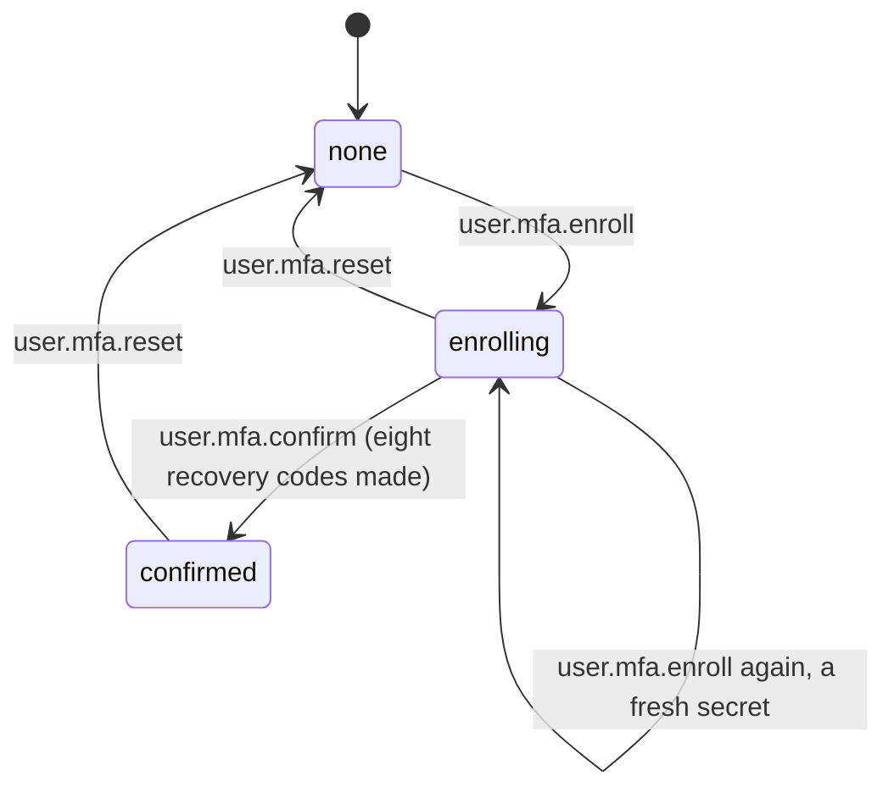

| From | To | By |
|---|---|---|
| none | enrolling | user.mfa.enroll |
| enrolling | enrolling | user.mfa.enroll again: a fresh secret |
| enrolling | confirmed | user.mfa.confirm (eight recovery codes made) |
| confirmed | none | user.mfa.reset |
| enrolling | none | user.mfa.reset |

- Recovery codes have no count on the wire; their use is an audit detail.
- "Enrolled" is read three ways: the raw row (sign-in, tokens, approvals, the command line), the provider-aware rule (the connect gate), and the posture SQL (the dashboard).

## Restart drain

No API field carries it. States: `idle`, `draining`, `ended sessions`, `exited`.

`SystemStatus.draining` with `drain{requested_at, deadline, wait_minutes, action}`; `idle` is the field absent. In memory only: a restart forgets it.

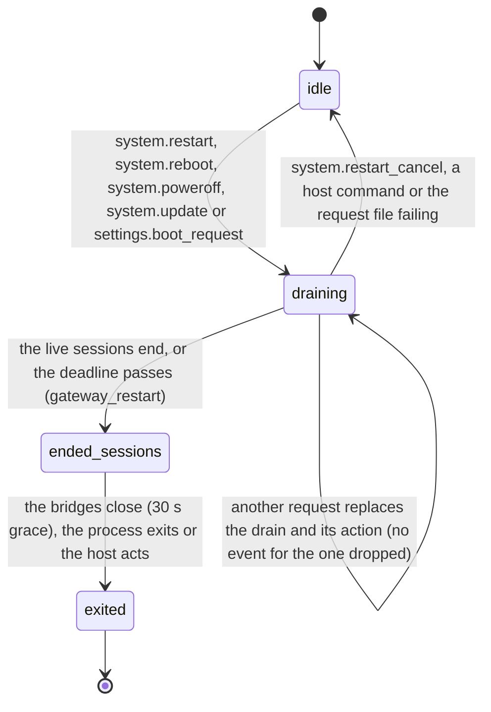

| From | To | By |
|---|---|---|
| idle | draining | system.restart, system.reboot, system.poweroff, system.update or settings.boot_request |
| draining | draining | another request replaces the drain and its action (no event for the one dropped) |
| draining | idle | system.restart_cancel; a host command or the request file failing |
| draining | ended sessions | the live sessions end, or the deadline passes (gateway_restart) |
| ended sessions | exited | the bridges close (30 s grace); the process exits or the host acts |

- The completion of a restart, reboot, power-off or update is never audited; the console infers it from a new `started_at`.
- "Cancel restart" cancels any drain, whatever its action.

## Install settings change

No API field carries it. States: `requested`, `written`, `applied`, `refused`, `rolled_back`.

`ConfigResult.state` is the helper's result file (`applied`, `refused`, `rolled_back`), read back by `GET /admin/settings/boot/result` and matched to the request id; `requested` and `written` are phases of the drain.

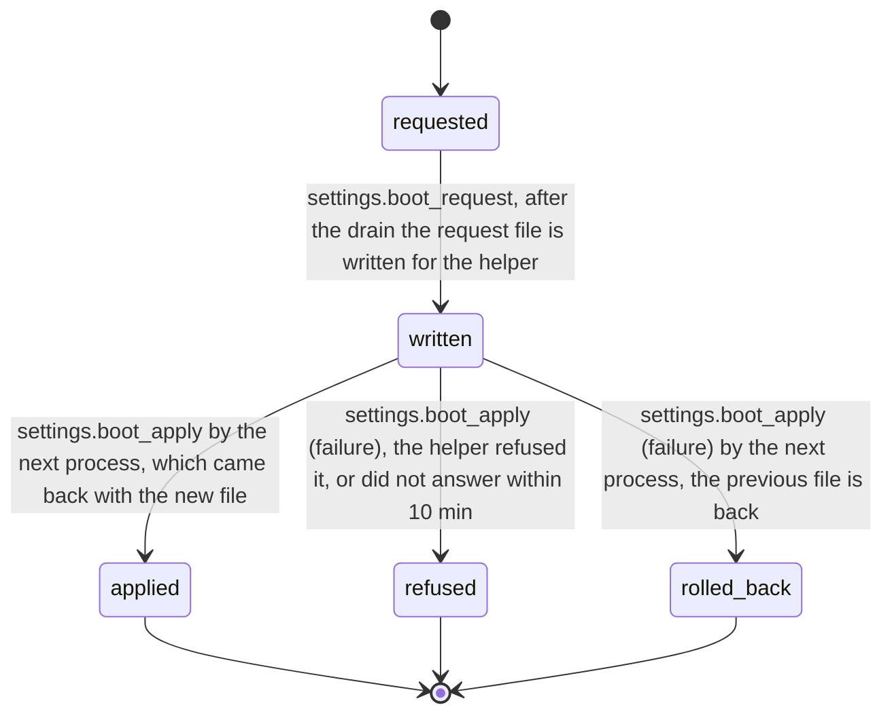

| From | To | By |
|---|---|---|
| requested | written | settings.boot_request; after the drain the request file is written for the helper |
| written | refused | settings.boot_apply (failure): the helper refused it, or did not answer within 10 min |
| written | applied | settings.boot_apply by the next process, which came back with the new file |
| written | rolled_back | settings.boot_apply (failure) by the next process: the previous file is back |

- The result file is a singleton that never expires: every reader compares the request id.

## Installer run

No API field carries it. States: `requested`, `running`, `done`, `failed`.

`UpdateStatus.install.state` is the installer's last report (`running`, `done`, `failed`), kept until the next run; `requested` is the drain.

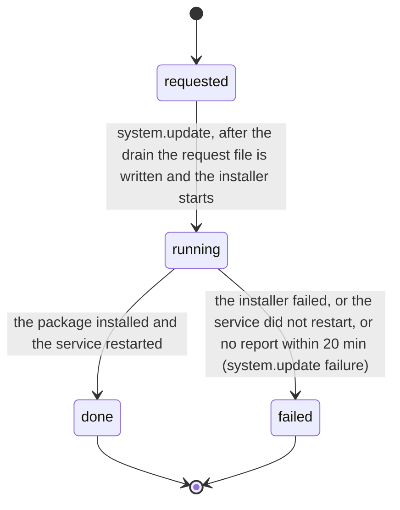

| From | To | By |
|---|---|---|
| requested | running | system.update; after the drain the request file is written and the installer starts |
| running | done | the package installed and the service restarted |
| running | failed | the installer failed, or the service did not restart; or no report within 20 min (system.update failure) |

- The words are written by a shell script and read by Go, the console and the OpenAPI enum; nothing shares them.

## Directory sync

No API field carries it. States: `not run`, `running`, `ok`, `held`, `failed`.

`IdentityProvider.sync`: `running`, `last{ok, error, held}` and `next_at`; absent for a provider that does not list (SCIM, sign-in only). The dashboard counts `failing`, `not_run` and `held_back`.

```mermaid
stateDiagram-v2
    [*] --> not_run
    not_run --> running: the first tick after start, or a manual run
    ok --> running: the interval passes, or a manual run
    held --> running: the interval passes, or a manual run (with apply_removals to force)
    failed --> running: the interval passes, or a manual run
    running --> ok: idp.sync when something changed, or on a manual run
    running --> held: removals held back, the listing was empty, or more than half the active accounts would go
    running --> failed: idp.sync (failure) on a new or changed error, notified as provider_failing
```

| From | To | By |
|---|---|---|
| not run | running | the first tick after start, or a manual run |
| ok | running | the interval passes, or a manual run |
| held | running | the interval passes, or a manual run (with apply_removals to force) |
| failed | running | the interval passes, or a manual run |
| running | ok | idp.sync when something changed, or on a manual run |
| running | held | removals held back: the listing was empty, or more than half the active accounts would go |
| running | failed | idp.sync (failure) on a new or changed error; notified as provider_failing |

- After a restart every provider reads `not run` until its first tick, so a failing provider's banner disappears and its next failure is announced again.
- "Not answering" on the sign-in page is the discovery probe, a different check from the sync.

## Notification channel

No API field carries it. States: `on`, `off`, `failing`.

`enabled` on the row; `status{last_sent_at, last_error, last_error_at}` from memory: `failing` is a `last_error` that no later delivery cleared.

```mermaid
stateDiagram-v2
    [*] --> on
    on --> off: notify.channel.update with enabled false
    off --> on: notify.channel.update with enabled true (the backlog since it went off is delivered)
    on --> failing: a delivery fails, retried with a backoff up to 5 min
    failing --> on: a pass delivers at least one message
    failing --> off: notify.channel.update with enabled false
```

| From | To | By |
|---|---|---|
| on | off | notify.channel.update with enabled false |
| off | on | notify.channel.update with enabled true (the backlog since it went off is delivered) |
| on | failing | a delivery fails; retried with a backoff up to 5 min |
| failing | on | a pass delivers at least one message |
| failing | off | notify.channel.update with enabled false |

- Delivery health is lost at restart; a stale error outlives a fix until a new matching event is delivered, and a passing Test does not clear it.

## Data key version

No API field carries it. States: `active`, `superseded`, `retired`.

`active` is the highest id with `retired_at` null; any other such row is `superseded`; `retired_at` set is `retired` and the version is not loaded. `rotated_at` is a different fact: the version was rewrapped by `key rotate-master`.

```mermaid
stateDiagram-v2
    [*] --> active
    active --> superseded: zanskar key rotate makes a newer version (key.rotate), this one only decrypts
    superseded --> retired: not built, nothing sets retired_at, ADR 0007 calls it future work
    retired --> [*]
```

| From | To | By |
|---|---|---|
| active | superseded | zanskar key rotate makes a newer version (key.rotate): this one only decrypts |
| superseded | retired | not built: nothing sets retired_at; ADR 0007 calls it future work |

- `retired_at` has readers and no writer; a version retired by hand while rows still reference it makes those rows unreadable.
