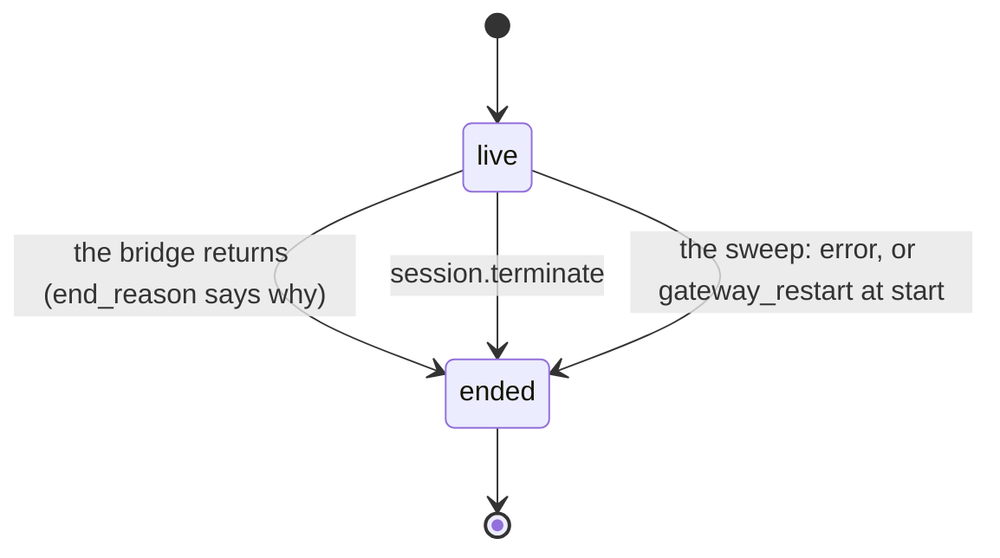
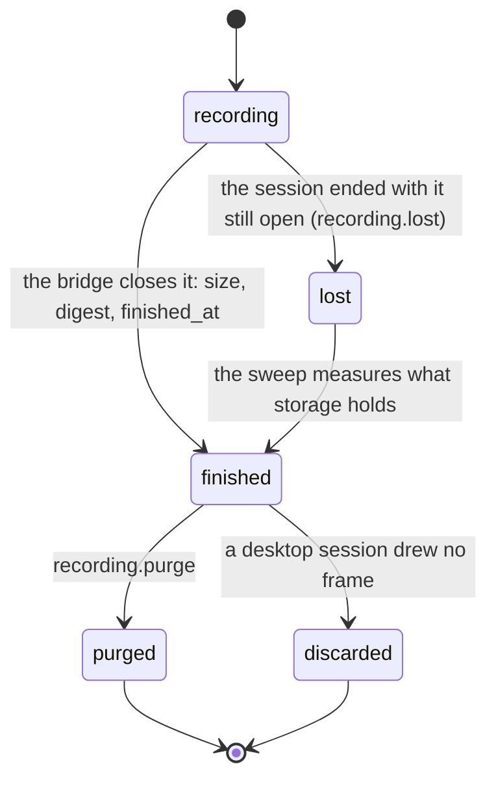
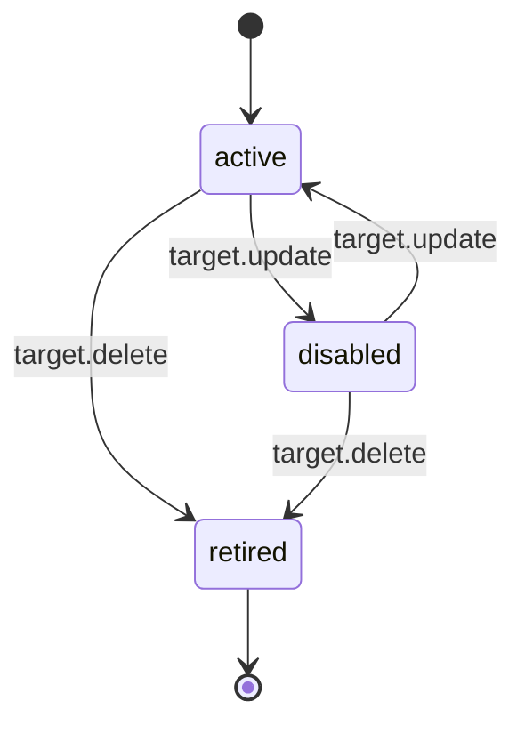
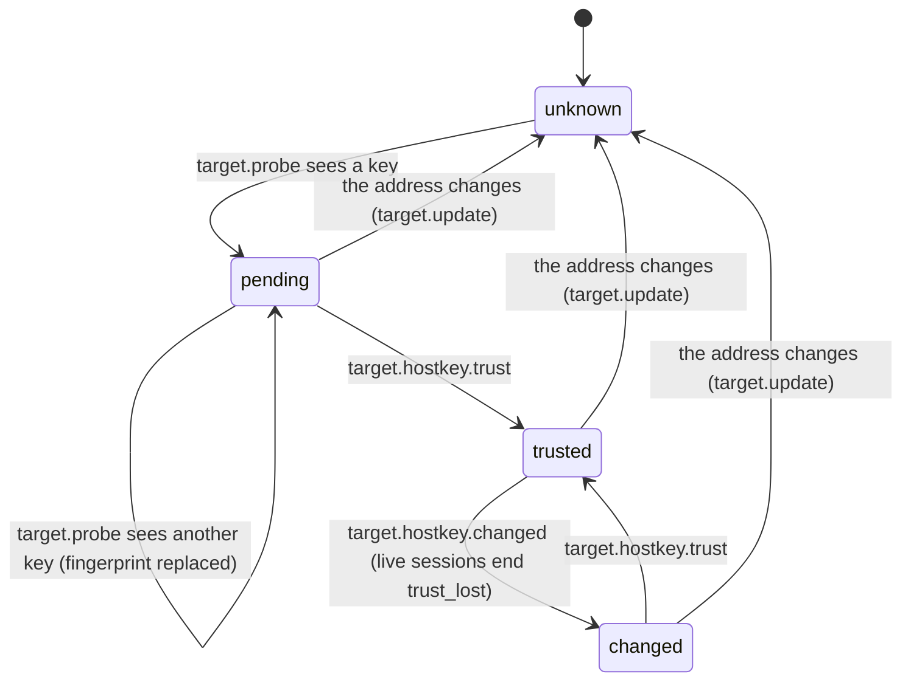
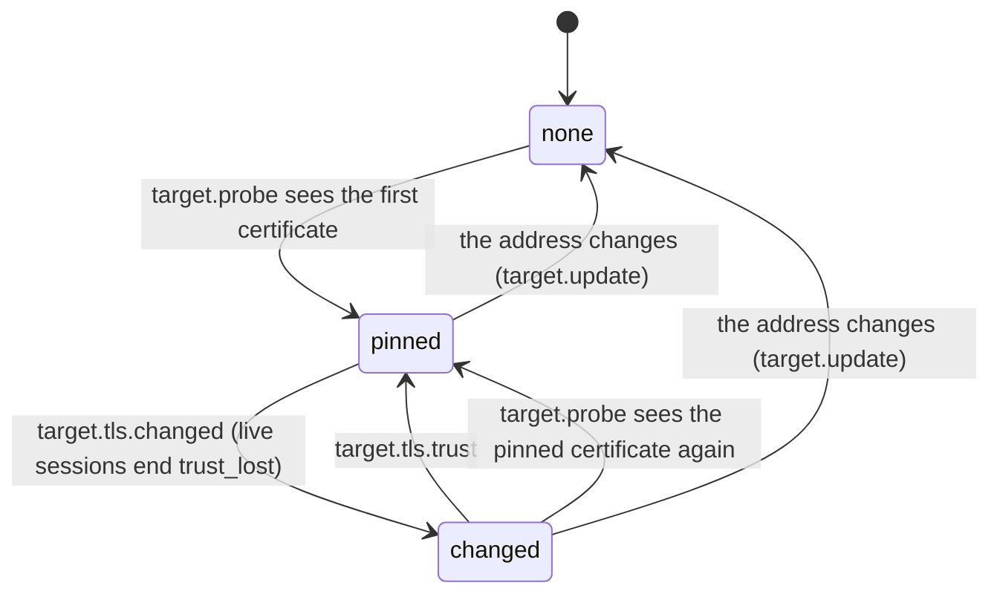
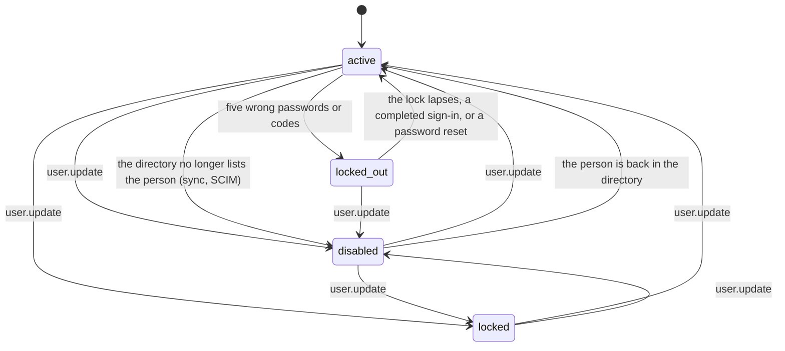
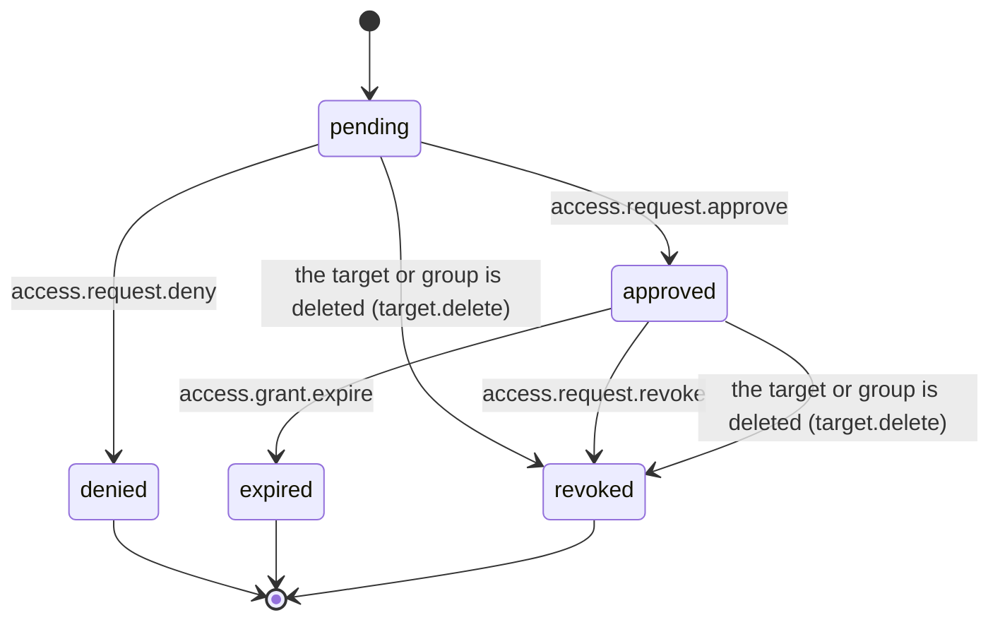
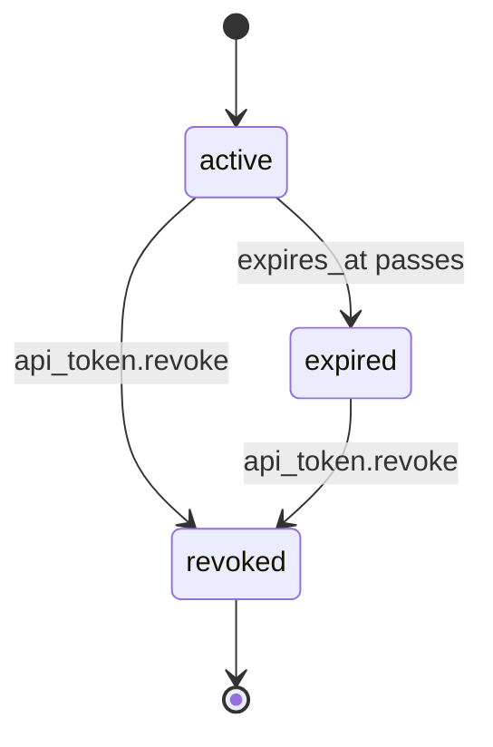
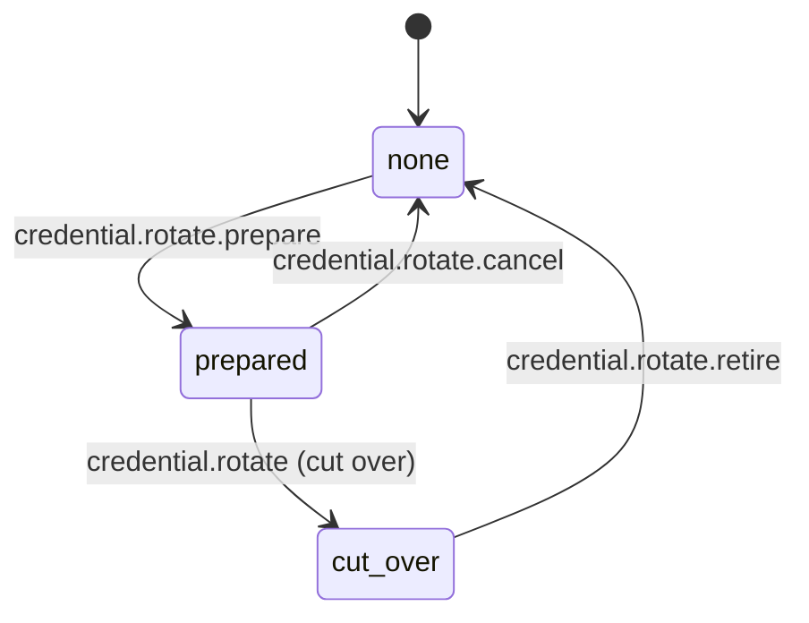
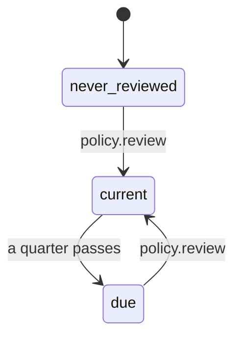

# Lifecycles

Generated from the declarations in the code (`go run ./hack/gen-lifecycles > docs/lifecycles.md`);
do not edit by hand. [ADR 0047](adr/0047-lifecycles-declared-once.md) is the decision.

Every record below has a stored `status` (what was set) and a computed `state` (what holds now,
from the row and the clock), or only the latter. The field named under each heading carries the state
on the wire; its OpenAPI enum, the console's labels in `web/src/api/states.ts` and this document are
held to the declaration by the tests in `cmd/zanskar/lifecycles_test.go`. A move is drawn with what
makes it: an audit action where one is recorded, otherwise the code path in words.

## Session

Field `state` on `OwnSession`, `AccessSession`. States: `live`, `ended`.

`live` while `ended_at` is null, else `ended`; `end_reason` says why and `end_detail` what was said. The row cannot tell a session that is still starting (dialling, pulling images) or still closing (uploading its recording) from one that is bridging: those phases live in the gateway's registry and starting set, and the sweep closes a row older than three minutes that neither knows.

- End reasons: `user_exit`, `idle_timeout`, `max_duration`, `admin_terminated`, `policy_revoked`, `trust_lost`, `gateway_restart`, `target_lost`, `target_deleted`, `failover`, `error`, `no_watcher`.
- `no_watcher` is kept for rows 1.15.0 ended under four eyes; nothing writes it since 1.16.0.
- A session's recording has a lifecycle of its own, below; `recording_state` carries it on the session for reviewers.

## Recording

Field `state` on `Recording`. States: `recording`, `finished`, `lost`, `purged`, `discarded`.

`discarded` when `discarded_at` is set, else `purged` when `purged_at` is set, else `finished` when `finished_at` is set, else `lost` when the session has ended, else `recording`. A session carries the same word as `recording_state` (reviewers only).

- A discarded recording is left out of the sessions list by the join; its row stays so the events that name it resolve.
- `lost` is also an audit event (`recording.lost`) and a notification; the row itself keeps `finished_at` null.

## Target

Field `state` on `Target`, `AutoscalingGroup`. States: `active`, `disabled`, `retired`.

The stored `status`. A retired row (`deleted_at` set) is read by no list or lookup, so `retired` never reaches the wire; it is declared so the document says where a deleted target goes.

- Retiring sets `status` to `disabled` as well, so every reader must add `deleted_at IS NULL`; the repository does.
- An update that leaves `status` out writes `active`: the API default, not the current value (OpenAPI `TargetWrite`).
- Autoscaling groups (`AutoscalingGroup.state`) follow the same lifecycle with `asg.update` and `asg.delete`.

## Host key

Field `host_key_status` on `Target`, `ProbeResult`. States: `unknown`, `pending`, `trusted`, `changed`.

The stored `host_key_status`; `host_key_fingerprint` is the key it speaks of.

- A key seen at a dial that differs from the trusted one is refused and audited (`target.hostkey.mismatch`) but changes no state: only a probe does.
- `unknown` also reads for a database or application, which is never probed for a key; the console hides it there.

## Certificate pin

Field `tls_status` on `Target`. States: `none`, `pinned`, `changed`.

`none` with no pin, `changed` while a pending fingerprint waits beside the pin, else `pinned`; `winrm_tls_status` is the same for the WinRM listener.

- Unlike the host key, the first certificate is pinned by the probe with no administrator's word, and a pending certificate does not stop a ticket: the session fails at redeem with `certificate_mismatch`.

## Autoscaling instance

Field `state` on `AsgInstance`. States: `healthy`, `unhealthy`, `terminated`.

`terminated` when `terminated_at` is set; else `healthy` when `healthy` holds (in service, load balancer healthy or absent, probe healthy); else `unhealthy`. A first sighting lands in `healthy` or `unhealthy`.

- Health has no time bound: a group that stops polling (disabled, or its sync failing) keeps each instance's last verdict.
- An instance whose pinned host key or certificate changed stays `unhealthy` while it presents the new one; no accept action exists.

## User

Field `state` on `User`. States: `active`, `locked_out`, `disabled`, `locked`.

`disabled` and `locked` are the stored `status`; an `active` account with `locked_until` in the future is `locked_out`; otherwise `active`. `directory_removed_at` beside `disabled` says the directory took the person away.

- `locked` behaves exactly like `disabled` and only a raw PUT sets it; whether to retire it is an open question of ADR 0047.
- Setting `status: active` does not clear a lockout; a password reset or a completed sign-in does.
- Deleting an account removes its row (ADR 0046): deletion is not a state.

## Access request

Field `state` on `AccessRequest`. States: `pending`, `approved`, `denied`, `expired`, `revoked`.

The stored `status`, except that `approved` with `expires_at` at or before now reads `expired`: the sweeper writes `expired` once a minute, and the clock is the truth in between. A grant is active while `state` is `approved`.

- Revoke applies to an active grant only; a lapsed one answers 409 with the state named.
- A pending request never expires on its own and cannot be withdrawn by the requester.

## API token

Field `state` on `APIToken`. States: `active`, `expired`, `revoked`.

`revoked` when `revoked_at` is set, else `expired` when `expires_at` is at or before now, else `active`.

- The owner's own state is not part of it: a token of a disabled, demoted or password-change-owing administrator reads `active` and is refused with 401 (ADR 0047, open question).
- Rows are never deleted; revoking twice keeps the first time.

## Authority rotation

Field `rotation_state` on `Credential`. States: `none`, `prepared`, `cut_over`.

`prepared` while `rotation.pending_public_key` is set, else `cut_over` while `rotation.retired_public_key` is set, else `none`. `ssh_ca` credentials only; absent on the others.

- One rotation at a time: preparing a next key is refused while a retired key waits to be confirmed removed (2026-11-09: the next cut-over overwrote the reminder).
- A row from before that rule may hold both keys; it reads `prepared`, and the console still shows both reminders.

## Access review

Field `review_state` on `AccessPolicy`. States: `never_reviewed`, `current`, `due`.

`never_reviewed` with no `reviewed_at`, `due` when it is older than ninety days, else `current`. The review view's `due` is the same rule.

- Editing a policy does not reset its review.
